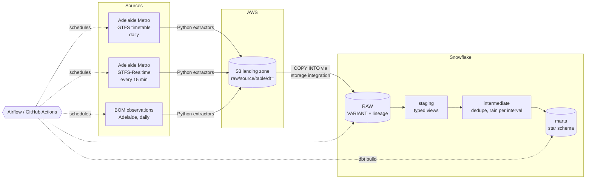
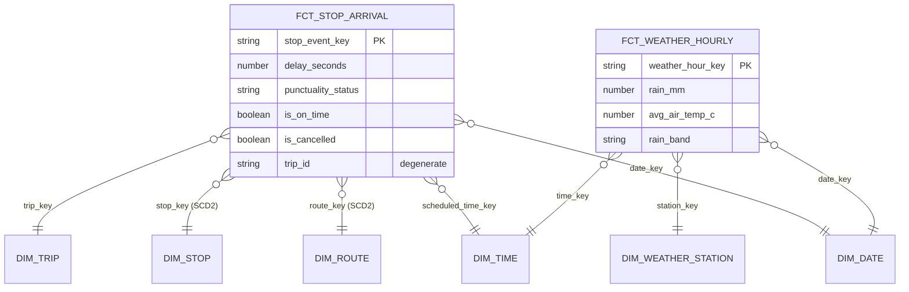

# Adelaide Transit Pipeline

**How punctual are Adelaide's buses, trains and trams, and does the weather make a difference?**

An end-to-end cloud data pipeline built on live public data. Adelaide Metro's
realtime feed and the Bureau of Meteorology's observations land in AWS S3, load
into Snowflake, and dbt models them into a Kimball star schema with data
quality tests. Airflow runs it daily; a GitHub Actions version does the same
without a server.



## Star schema



| Model | Grain | Kimball notes |
|---|---|---|
| `fct_stop_arrival` | one stop visit (service day × trip × stop) | Transaction fact, incremental merge. trip_id, stop_sequence and vehicle_id kept as degenerate dimensions |
| `fct_weather_hourly` | station × clock hour | Periodic snapshot fact |
| `dim_route`, `dim_stop` | one row per version | **Type 2 SCD** from dbt snapshots; facts join "as at" the service day |
| `dim_trip` | one row per trip | Type 1 (trip_ids are replaced between timetables, not edited) |
| `dim_date` | one row per day | Smart key YYYYMMDD, SA public holidays, AU financial year, transit day type |
| `dim_time` | one row per minute | Separate from date (1,440 rows), with peak / interpeak bands |
| every dimension | | Has an **unknown member** (`-1`) so facts never carry NULL foreign keys |

Two analytics views sit on top: `mart_route_punctuality_daily` (on-time % per
route per day) and `mart_delay_by_weather` (delay by mode, time of day, rain
band and temperature band).

## Design decisions worth talking about

- **Realtime capture never touches Snowflake.** Snapshots go to S3 every 15
  minutes; one daily `COPY` loads them all. Loading every 15 minutes would wake
  the warehouse 96 times a day, and at Snowflake's 60-second minimum billing
  that alone would cost more than the rest of the project combined.
- **RAW tables are schemaless** (`record VARIANT` + file name, row number, load
  time). A new column upstream can't break the load; typing happens in dbt.
- **Loads are idempotent.** S3 objects are immutable and `COPY INTO` skips files
  it has already loaded, so any step can be re-run safely.
- **The timetable only lands when it changes.** The GTFS zip is hashed; an
  unchanged feed is skipped instead of reloading ~1.5M identical rows a day.
- **Overlapping weather files on purpose.** BOM publishes a rolling 72 hours.
  Daily runs overlap by ~48h, so one failed run loses nothing; dbt dedupes.
- **BOM's "rain since 9am" is cumulative**, so the intermediate model diffs
  consecutive readings within each 9am-to-9am rain day. A singular test checks
  the derived intervals add back up to BOM's own daily total.
- **GTFS times can exceed 24:00** (a trip at "25:10" is 1:10am but belongs to
  the previous service day), so they're stored as seconds from service-day start.
- **Cancelled trips don't disappear.** Feeds often send a cancellation with no
  stop detail, so cancelled trips are expanded to their scheduled stops.
- **No stored credentials:** key-pair auth for Snowflake, a storage integration
  (IAM role) between Snowflake and S3, and GitHub OIDC for AWS.

## Data quality

About 100 dbt tests (exact count printed by CI):

- `unique` / `not_null` on every primary key, `relationships` from every fact
  foreign key to its dimension
- `accepted_values` on GTFS enums and derived categories; `accepted_range` on
  coordinates, delays, temperatures and rainfall (warn-only where outliers are real)
- custom generic test `not_in_future`, which catches UTC-vs-Adelaide-time bugs
- singular tests: SCD2 windows never overlap, the fact has exactly one row per
  stop event (no fan-out from the type 2 joins), derived rain reconciles to
  BOM's totals, and yesterday has enough realtime snapshots
- source freshness on the realtime and weather tables
- failing rows are stored in a `TEST_FAILURES` schema for debugging

## Repository layout

```
ingestion/          Python extractors (GTFS static, GTFS-RT, BOM) and Snowflake loader
snowflake/          One-off setup SQL: warehouse, roles, RAW tables, S3 integration
infra/aws/          IAM policies and AWS CLI steps for the bucket and roles
dbt/                Staging -> intermediate -> marts, snapshots, seeds, tests, macros
airflow/            Two DAGs (daily pipeline, 15-min realtime capture) + Docker setup
.github/workflows/  CI on every PR, plus the daily pipeline and realtime capture
scripts/            Run recorder and the metrics queries for your numbers
tests/              Offline unit tests for the extractors
```

## Setup

You'll need: an AWS account, a Snowflake trial, Python 3.11, Docker (for
Airflow) and a GitHub repo.

### 1. Try it locally first (no cloud accounts)

```bash
make install && . .venv/bin/activate
make test             # offline unit tests
make extract-local    # pulls live data into ./data_lake
```

### 2. Snowflake

1. Sign up for a trial and pick **AWS, Asia Pacific (Sydney)**, the same region
   as your bucket, so S3 to Snowflake transfer is free.
2. Make a key pair for the service user:
   ```bash
   mkdir -p ~/.snowflake && cd ~/.snowflake
   openssl genrsa 2048 | openssl pkcs8 -topk8 -inform PEM -out snowflake_key.p8 -nocrypt
   openssl rsa -in snowflake_key.p8 -pubout -out snowflake_key.pub
   ```
3. Run `snowflake/01_setup.sql` in a worksheet, then
   `ALTER USER SVC_TRANSIT_PIPELINE SET RSA_PUBLIC_KEY='<body of snowflake_key.pub>';`

### 3. AWS

Follow `infra/aws/README.md`: bucket, the role Snowflake reads through, and
the GitHub OIDC role. That walks you through `snowflake/02_s3_integration.sql`.

### 4. Configure and run once by hand

```bash
cp .env.example .env     # fill in bucket + Snowflake account
make extract && make load
make dbt-dev             # seed, snapshot, build + test into DBT_<you>
make dbt-docs            # lineage graph at localhost:8081
```

### 5. Schedule it (pick one)

**Airflow:** `make airflow`, open http://localhost:8080 and switch on both DAGs.

**GitHub Actions:** add these repository secrets, and the workflows in
`.github/workflows` run on their own:

| Secret | Value |
|---|---|
| `S3_BUCKET` | your bucket name |
| `AWS_ROLE_ARN` | ARN of `github-transit-pipeline` |
| `SNOWFLAKE_ACCOUNT` | account identifier |
| `SNOWFLAKE_USER` | `SVC_TRANSIT_PIPELINE` |
| `SNOWFLAKE_PRIVATE_KEY` | full contents of `snowflake_key.p8` |

The 15-minute capture is free on a public repo. On a private repo, run it as a
Lambda instead (see `infra/aws/README.md`).

## Measuring the results

Every load writes row counts to `OPS.LOAD_LOG`; every run writes duration and
test results to `OPS.PIPELINE_RUNS`. After a few weeks, run
`scripts/metrics.sql` for:

- total and daily rows processed
- tests per run and pass rate
- median and p90 run time
- Snowflake credits per month (multiply by your price per credit, shown under
  Admin → Cost Management) plus storage

Expect roughly: the realtime feed is the volume driver (on the order of a
million rows a day, depending on how many trips are running); the daily run is
a few minutes on an X-Small warehouse. Measure rather than quote these.

**Cost guardrails:** X-Small warehouse, 60-second auto-suspend, and a
10-credit monthly resource monitor that suspends the warehouse if reached.
The Snowflake trial lasts 30 days, so plan to collect your numbers within it,
or keep running on a pay-as-you-go account with the cap in place.

## Assumptions and limits

- **Delay** is the last delay estimate seen before a vehicle left the feed, not
  a confirmed arrival. Feeds don't publish actual arrivals.
- **On time** = up to 59s early to 4m59s late, a common Australian
  convention. It's a dbt variable (`on_time_*_seconds`) so it's easy to change.
- **Peak bands** in `dim_time` are an analysis choice, not an Adelaide Metro
  definition.
- **Weather** comes from one station (Adelaide, West Terrace). Swap the URL in
  `.env` for another BOM station.
- **Public holidays** are seeded from SafeWork SA for 2025-2027; extend yearly.
- Adelaide Metro feed URLs can change; they're overridable in `.env`.

## Data and licences

- Transit data: **Adelaide Metro – Department for Infrastructure and Transport,
  South Australia**, Creative Commons Attribution.
- Weather data: © Commonwealth of Australia, Bureau of Meteorology. Check BOM's
  copyright notice before republishing the raw data.
